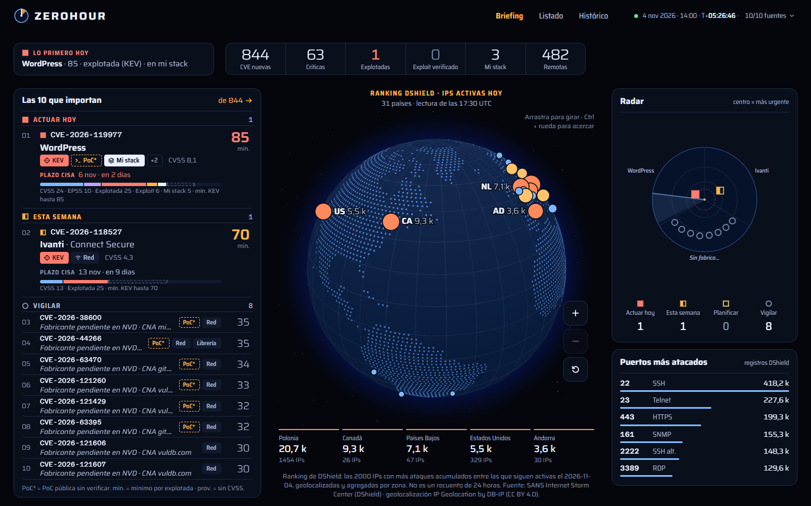
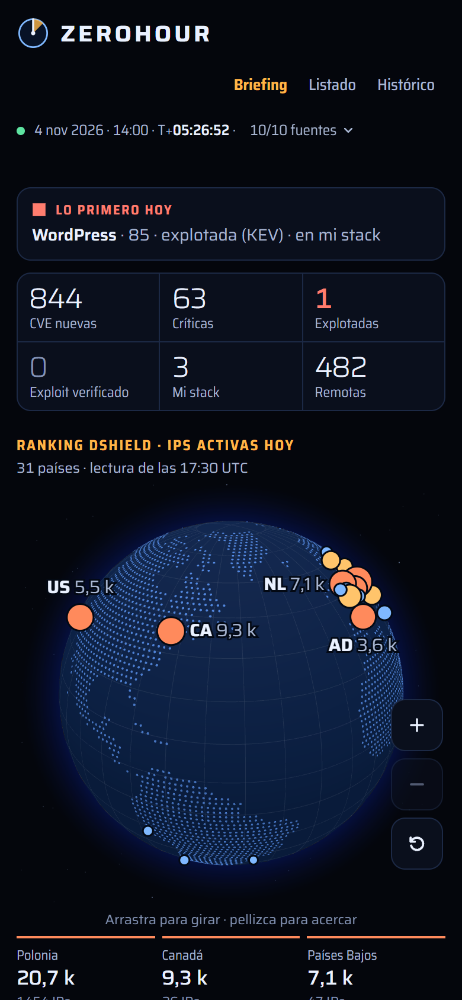
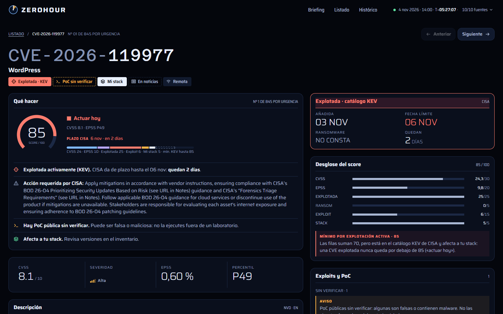
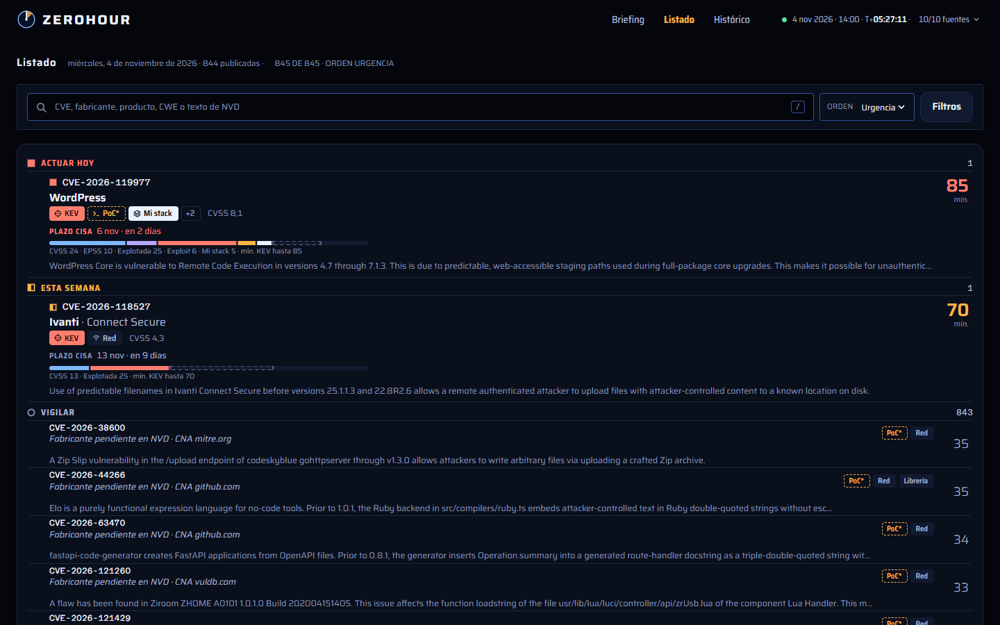

# ZEROHOUR

**Inteligencia de vulnerabilidades** · por Adrián López Olaria

Briefing diario de vulnerabilidades: cada mañana cruza fuentes públicas, puntúa de 0 a 100 lo que de verdad importa y publica una web estática con el resultado. Además, cada 3 horas actualiza un mapa mundial de actividad de ataques.

En producción en **<https://zerohour-cve.dev>**.

Todo corre gratis: el pipeline en **GitHub Actions** y la web en **Cloudflare Workers** (solo ficheros estáticos), con cabeceras de seguridad estrictas (CSP sin excepciones y Trusted Types).



| Móvil (390 px) | Ficha de una CVE | Listado |
|---|---|---|
|  |  |  |

El diseño es «Órbita»: el globo manda y los datos orbitan a su alrededor. Los colores y las medidas viven en [`web/assets/css/tokens.css`](web/assets/css/tokens.css). Las fuentes son Saira y Azeret Mono (OFL), autoalojadas: ver [`FUENTES.md`](web/assets/fonts/FUENTES.md).

Anchos intermedios: [1024 px](docs/capturas/orbita-briefing-1024.png) · [768 px](docs/capturas/orbita-briefing-768.png) · histórico: [1440 px](docs/capturas/orbita-historico-1440.png).

## Qué responde cada mañana

- **Qué hay que parchear hoy.** Las CVE del día puntuadas de 0 a 100 y agrupadas en cuatro veredictos: ACTUAR HOY · ESTA SEMANA · PLANIFICAR · VIGILAR.
- **Qué se está explotando ya.** Nuevas en el catálogo KEV de CISA y CVE que CISA marca como explotadas (SSVC) antes de que entren en KEV.
- **Qué tiene código de ataque.** Exploits verificados (Metasploit, Exploit-DB), plantillas de detección (Nuclei) y PoC públicas sin verificar, cada uno con su peso.
- **Qué me toca a mí.** Las que afectan a tu stack (`config.toml`).
- **Desde dónde atacan.** Un globo interactivo con el ranking de DShield de las IPs activas hoy, por país (se arrastra para girarlo y vuelve a girar solo 1 s después de soltarlo), y los puertos más atacados. Sin WebGL hay un globo SVG de respaldo con el mismo comportamiento.
- **Cuánto tiempo hay.** El plazo que da CISA para parchear cada CVE del catálogo KEV y el desglose del score, para saber de qué está hecho el número.

## Fuentes

Trece fuentes de datos, más prensa especializada y geolocalización offline:

| Fuente | Qué aporta |
|---|---|
| [NVD (NIST)](https://nvd.nist.gov/developers/vulnerabilities) | CVE nuevas, descripción, CVSS, productos (CPE), CWE |
| [CVE.org (cvelistV5)](https://github.com/CVEProject/cvelistV5) + [CISA Vulnrichment](https://github.com/cisagov/vulnrichment) | SSVC de CISA (explotación, automatizable, impacto) y CVSS del CNA o de CISA cuando NVD aún no puntúa |
| [CISA KEV](https://www.cisa.gov/known-exploited-vulnerabilities-catalog) | Explotación activa confirmada y uso en ransomware |
| [EPSS (FIRST)](https://www.first.org/epss/) | Probabilidad de explotación en los próximos 30 días |
| [GitHub Advisories](https://github.com/advisories) | Vulnerabilidades en librerías (npm, PyPI, Maven…) |
| [Metasploit](https://github.com/rapid7/metasploit-framework) · [Nuclei](https://github.com/projectdiscovery/nuclei-templates) · [Exploit-DB](https://gitlab.com/exploit-database/exploitdb) | Exploits verificados (módulos de Metasploit, exploits verificados de Exploit-DB) y plantillas de detección de Nuclei |
| [PoC-in-GitHub](https://github.com/nomi-sec/PoC-in-GitHub) | PoC públicas **sin verificar** (algunas son falsas o maliciosas) |
| [INCIBE-CERT](https://www.incibe.es/incibe-cert/alerta-temprana/avisos) · [CERT-EU](https://cert.europa.eu/publications/security-advisories) + noticias (RSS) | Avisos oficiales (CERT-EU solo publica los que considera graves) y contexto de prensa especializada |
| [SANS ISC / DShield](https://isc.sans.edu/) | IPs que más atacan y puertos más atacados (mapa) |
| [Cloudflare Radar](https://radar.cloudflare.com) | Rayas de ataques web (capa 7) mitigados por Cloudflare, origen → destino, últimas 24 h (globo). El token solo se usa en el job `recolectar` |
| [DB-IP Lite](https://db-ip.com/db/lite.php) | Geolocalización **offline** de esas IPs: la base mensual se descarga por HTTPS, se verifica con el SHA-1 que publica DB-IP y se consulta en local (en el mapa solo se publican zonas, nunca IPs) |

> Geolocalización: <a href="https://db-ip.com">IP Geolocation by DB-IP</a>, con licencia [CC BY 4.0](https://creativecommons.org/licenses/by/4.0/).
>
> Datos de ataques (rayas origen → destino): [Cloudflare Radar](https://radar.cloudflare.com), con licencia [CC BY-NC 4.0](https://creativecommons.org/licenses/by-nc/4.0/).
>
> This product uses the NVD API but is not endorsed or certified by the NVD.

## Arquitectura

```
 Fuentes públicas (NVD, CVE.org, CISA KEV, EPSS, GHSA, Metasploit, Nuclei, Exploit-DB,
 PoC-in-GitHub, RSS de INCIBE-CERT / CERT-EU / prensa, SANS ISC) + DB-IP Lite (offline)
                │  HTTPS, todo tratado como hostil
                ▼
 ┌──────────────────────────── GitHub Actions (cron 05:17 UTC y cada 3 h) ───────────────────┐
 │ recolectar · contents: read   radar.py → data/*.json → validar_datos.py → artifact        │
 │ publicar   · contents: write  montar_deploy.py: web/ + datos + _headers (de cabeceras.toml)  │
 │                               → commit huérfano y force-push SOLO a la rama deploy         │
 │ desplegar  · contents: read   wrangler deploy de ese commit exacto (entorno «cloudflare»)  │
 └────────────────────────────────────────────────────────────────────────────────────────────┘
                ▼
 Cloudflare Workers (solo ficheros estáticos, sin código de Worker) · https://zerohour-cve.dev
                ▼
 Navegador: HTML + ES modules sin build, CSP estricta con Trusted Types. Los JSON se pintan
 con createElement/textContent; globe.gl y three.js autoalojados y cargados en diferido.
```

- **Sin backend ni base de datos.** Todo lo que ve la web son JSON estáticos regenerados por el workflow.
- **Sin paso de build en el frontend.** `web/` se publica tal cual (módulos ES nativos); no hay npm en la web.

## Cómo se publica

- **`main` solo tiene código.** Los datos nunca se suben a `main`, así que su historial no crece cada día.
- **`deploy` es el sitio ya montado** y tiene siempre **un único commit**: cada publicación lo reemplaza con un commit huérfano y *force-push*. El *force-push* solo existe hacia `deploy`: el destino está fijado en `scripts/publicar_deploy.sh` y un test lo comprueba.
- **Tres jobs con permisos mínimos.** `recolectar` (`contents: read`) ejecuta el pipeline y recupera el histórico de 90 días **desde `deploy`**. `publicar` (`contents: write`) solo valida, monta y empuja, sin instalar nada. `desplegar` (`contents: read`) sube a Cloudflare exactamente ese commit de `deploy` con `wrangler`, instalado con `npm ci --ignore-scripts` desde un lockfile con hashes; es el único paso que ve el token de Cloudflare.
- **Una sola fuente de cabeceras.** `cabeceras.toml` define la CSP, el resto de cabeceras y la caché; `scripts/montar_deploy.py` lo traduce al `_headers` de Cloudflare y los tests comprueban, ruta a ruta, que salen idénticas.
- **Si los datos no pasan `scripts/validar_datos.py`, no se publica nada** y la web sigue con la edición anterior. Lo mismo si el histórico pierde días recientes.
- **Un cambio de código en `main`** (web, `cabeceras.toml` o scripts de publicación) regenera `deploy` reutilizando los datos ya publicados.
- Cada recolección diaria guarda además una copia de los datos como *artifact* durante 7 días.

## Puesta en marcha

1. **Repo público en GitHub** (minutos de Actions ilimitados). En **Settings → Actions → General → Workflow permissions** deja **Read repository contents** (solo lectura): el único job que escribe pide `contents: write` él mismo, y solo puede escribir en `deploy`.
2. **Clave de NVD:** pide una gratuita en <https://nvd.nist.gov/developers/request-an-api-key> y guárdala en **Settings → Secrets and variables → Actions** como `NVD_API_KEY`. Funciona sin ella, pero mucho más lento.
3. **Primera ejecución:** **Actions → ZEROHOUR → Run workflow** con el modo `all`. Crea la rama `deploy`. Desde ahí se ejecuta solo: briefing a las 05:17 UTC y mapa cada 3 horas.
4. **Cloudflare:**
   - Crea un API token con un único permiso: **Account → Workers Scripts → Edit**, limitado a tu cuenta. No necesita permisos de zona.
   - En GitHub, **Settings → Environments → New environment** `cloudflare`, restringido a la rama `main`, con los secrets `CLOUDFLARE_API_TOKEN` y `CLOUDFLARE_ACCOUNT_ID` y la variable `SITIO_URL` (la URL pública; el workflow comprueba allí que la edición nueva ya se sirve).
   - El dominio propio se conecta desde el panel (**Workers & Pages → zerohour → Settings → Domains & Routes → Custom domain**), así el token sigue sin permisos de zona. En la zona, apaga todo lo que inyecte o reescriba HTML (Rocket Loader, Email Obfuscation, Web Analytics automático, Zaraz, Bot Fight Mode): rompería la CSP.

### Ejecutarlo en local

```bash
python -m venv .venv && . .venv/bin/activate      # en Windows: .venv\Scripts\activate
pip install --require-hashes -r requirements-dev.txt
export NVD_API_KEY=tu_clave                        # opcional
python scripts/radar.py daily                      # informe del día → data/
python scripts/radar.py map                        # mapa de ataques → data/map.json
python scripts/radar.py all                        # ambos

python scripts/dev_server.py                       # http://127.0.0.1:8000 con las cabeceras de producción
python scripts/dev_server.py --dev                 # además /?fixtures=normal|vacio|error|xss (solo en local)
python -m pytest tests/pipeline                    # tests del pipeline, la publicación y las cabeceras
node --test "tests/unit/*.test.mjs"                # planificador de disparos del mapa
```

`dev_server.py` lee `cabeceras.toml` y manda las mismas cabeceras que producción, así que una violación de CSP o de Trusted Types aparece en local antes de publicar. Solo escucha en `127.0.0.1` y, a diferencia de producción, quita `upgrade-insecure-requests`, que en `http://127.0.0.1` haría pedirlo todo por https. Los *fixtures* de prueba, incluido el de XSS, solo se sirven con `--dev` y nunca llegan a `deploy`.

## Personalizar (`config.toml`)

- **`[stack]`**: palabras que marcan una CVE con ⭐ "afecta a mi stack". Cuentan si aparecen en fabricante, producto, CNA o CPE (fabricante:producto) o en la descripción.
- **`[stack.excluir]`**: patrones por palabra que anulan la coincidencia en la descripción. Por ejemplo, "wordpress" no cuenta en "The X plugin for WordPress…" (un plugin de terceros), pero sí en un fallo de WordPress core aunque aún no tenga CPE.
- **`[[fabricante]]`**: patrones para deducir fabricante y producto de la descripción cuando NVD aún no los da (p. ej. "Plugin WordPress · X"). Si ninguno casa, `vendor` queda vacío y la CNA va en su propio campo: la web muestra «Fabricante pendiente en NVD · CNA x» y el radar agrupa esas CVE en el sector «SIN FABRICANTE». La CNA nunca se presenta como fabricante.
- **`[marcas]`**: grafía correcta de marcas (GitLab, VMware ESXi, FortiOS, pfSense…). Lo que no está en el mapa se deja como venga.
- **`[puntuacion]`** y **`[puntuacion.minimos]`**: pesos y mínimos de la puntuación (ver abajo).
- **`[[rss]]`**: añade o quita fuentes de avisos y noticias.
- **`[ia]`**: pon `activado = true` para que el resumen lo escriba un LLM gratis vía GitHub Models. Si falla, se usa el resumen por plantilla.

### Cómo se calcula la puntuación

La puntuación (0-100) es la suma de seis filas. Los pesos viajan en el JSON (`scoring_weights`) y el desglose de cada CVE en `score_breakdown`, de modo que la web pinta el dial a partir de los datos, sin pesos fijos en el código.

| Fila | Puntos | Cuándo |
|---|---|---|
| CVSS | hasta 30 | 3 por punto de CVSS. Si aún no hay CVSS (ni de NVD, ni del CNA, ni de CISA): valor neutro del 40 % y score provisional (marcado con *) |
| EPSS | hasta 20 | Percentil EPSS × 20 |
| Explotada | 25 / 20 | 25 si está en CISA KEV. 20 si CISA la marca con SSVC «active» sin estar aún en KEV. Nunca las dos |
| Ransomware | 5 | Uso conocido en campañas de ransomware (según KEV) |
| Exploit | 15 / 6 | 15 con exploit verificado (Metasploit, Exploit-DB verificado o plantilla de Nuclei). 6 con PoC sin verificar (PoC-in-GitHub, referencia de NVD etiquetada como exploit o SSVC «poc») |
| Stack | 5 | Afecta a tu stack |

**Mínimos por explotación activa.** Una CVE explotada nunca puede quedar en «PLANIFICAR»:

- explotada (KEV o SSVC «active») → **al menos 70** («ESTA SEMANA»);
- explotada y además en tu stack, con ransomware o con exploit verificado → **al menos 85** («ACTUAR HOY»).

Cuando se aplica un mínimo, el JSON lo indica en `score_breakdown.floor` (valor, por qué está explotada y qué lo agrava) y la ficha lo explica debajo del dial.

**Veredicto y orden.** ACTUAR HOY ≥ 85 · ESTA SEMANA ≥ 70 · PLANIFICAR ≥ 40 · VIGILAR < 40. Las listas se ordenan por veredicto y, dentro de cada uno, por la suma real de las filas (y después por CVSS). Así, de dos CVE subidas a 85 por el mínimo, va primero la que más puntos tenía de verdad.

## Datos generados (para el frontend)

El pipeline escribe en `data/` (ignorada por git). Al publicar, `scripts/montar_deploy.py` copia a `deploy` **solo** lo que la web usa, desde una lista blanca:

| Fichero | Contenido | Se actualiza | ¿Se publica? |
|---|---|---|---|
| `latest.json` | Informe del día | Diario | Sí |
| `days/AAAA-MM-DD.json` | Informes anteriores (90 días) | Diario | Sí |
| `index.json` | Lista de días con estadísticas y top (histórico y gráficas) | Diario | Sí |
| `advisories.json` | Avisos de GitHub sin CVE asociada (para un futuro panel de librerías) | Diario | Sí |
| `map.json` | Puntos del mapa, ranking por país y puertos más atacados | Cada 3 h | Sí |
| `linkedin.md` | Borrador de post con el top 3 del día | Diario | **No** |

**`latest.json`**

```jsonc
{
  "date": "2026-10-31",
  "generated_at": "2026-10-31T05:24:10+00:00",
  "summary": "Hoy se han publicado 447 CVE nuevas: 37 críticas…",
  "stats": { "new_cves": 447, "by_severity": {"CRITICAL": 37, "HIGH": 176, "UNSCORED": 18},
             "kev_new": 6, "with_poc": 20, "with_exploit": 2, "with_detection": 0,
             "in_stack": 4, "remote": 370, "ghsa": 70, "news": 36 },
  "scoring_weights": { "cvss": 30, "epss": 20, "explotada": 25, "ransomware": 5, "exploit": 15, "stack": 5 },
  "top":      ["CVE-2026-97229", "CVE-2026-46300"],   // IDs: los objetos están en cves
  "kev_new":  ["CVE-2026-97229"],                     // recién añadidas a KEV, aunque sean antiguas
  "cves":     [ /* todas, ordenadas por urgencia */ ],
  "news":     [ /* avisos INCIBE-CERT y CERT-EU, y noticias */ ],
  "sources_status": { "nvd": "ok", "kev": "ok", "epss": "ok", "ghsa": "ok", "rss": "ok", "poc": "ok",
                      "cvelist": "ok", "metasploit": "ok", "nuclei": "ok", "exploitdb": "ok" }
}
```

**Severidad (`severity` y claves de `by_severity`).** NVD usa las bandas CVSS v3.1: `CRITICAL`, `HIGH`, `MEDIUM`, `LOW` y `NONE` (CVSS 0.0). Las CVE todavía sin puntuar aparecen como `UNSCORED` (`severity: null`). El frontend muestra cuatro bandas de color; por eso **pliega `NONE` dentro de `LOW`** (la banda más baja) al contar `by_severity`, de modo que la suma de las bandas sigue cuadrando con `new_cves`. No se pierde ningún CVE: `NONE` son casos sin impacto de seguridad (p. ej. registro insuficiente) que se agrupan con los de menor severidad. `UNSCORED` se cuenta aparte, nunca como 0 puntos (ver [Cómo se calcula la puntuación](#cómo-se-calcula-la-puntuación)).

**Objeto CVE**

```jsonc
{
  "id": "CVE-2026-46300",
  "description": "…",
  "vendor": "Linux", "product": "Linux Kernel", "cna": "",
  "cvss": 7.8, "severity": "HIGH", "vector": "CVSS:3.1/AV:L/…", "attack_vector": "LOCAL",
  "cvss_source": "nvd",                         // nvd | cna | cisa
  "epss": 0.1613, "epss_percentile": 0.969,
  "kev": { "date_added": "2026-10-28", "due_date": "2026-10-31", "ransomware": false, "action": "…" },
  "ssvc": { "exploitation": "active", "automatable": "no", "technical_impact": "total" },
  "exploits": [ { "source": "metasploit", "name": "exploit/linux/local/…", "url": "https://…", "verified": true } ],
  "poc": [ { "url": "https://github.com/…", "name": "…", "stars": 16, "description": "…" } ],
  "ghsa": [], "news": [ { "title": "…", "url": "…", "source": "INCIBE-CERT Avisos" } ],
  "stack": [],
  "score": 85,
  "score_breakdown": { "cvss": 23.4, "epss": 19.3854, "explotada": 25, "ransomware": 0, "exploit": 15, "stack": 0,
                       "floor": { "value": 85, "exploited_by": "kev", "aggravating": ["exploit"] } },
  "tags": ["kev", "exploit"],                   // kev ssvc ransomware exploit deteccion poc stack incibe certeu news remote library
  "cwe": ["CWE-787"],
  "references": [ { "url": "https://…", "tags": ["Patch"] } ],   // las 8 primeras
  "references_total": 10,
  "old_cve": true                               // solo si es antigua pero entró en KEV estos días
}
```

**`map.json`**

```jsonc
{
  "updated_at": "…",
  "data_day": "2026-11-03",
  "dshield_ips": 3300,
  "note": "Ranking de DShield: las 3300 IPs con más ataques acumulados entre las que siguen activas el 2026-11-03…",
  "points": [ { "lat": 39.9, "lon": 116.4, "country": "China", "cc": "CN", "attacks": 15230, "sources": 12 } ],
  "by_country": [ { "cc": "CN", "country": "China", "attacks": 80000, "sources": 40 } ],
  "top_ports": [ { "port": 23, "records": 500000, "sources": 9000, "targets": 30000 } ],
  "attack_pairs": [ { "from_cc": "CN", "to_cc": "US", "share": 5.62 } ],   // Cloudflare Radar, hasta 100 pares: solo %, sin recuentos; from==to → pulso
  "attack_pairs_source": "Cloudflare Radar (CC BY-NC 4.0)",
  "attack_pairs_range": { "start": "…", "end": "…" }, "attack_pairs_updated_at": "…",
  "sources_status": { "radar": "ok" }
}
```

> **Qué es (y qué no es) el mapa.** `sources/attacks/{n}/{fecha}` de SANS ISC no es un top del día: es el ranking acumulado de DShield (IPs vistas desde hace años) filtrado a las que siguen activas desde esa fecha. Se piden 3300 IPs (`[mapa] ips`), se geolocalizan offline con DB-IP y se agregan por zona y país; **no se publica ninguna IP**. El panel se titula «RESUMEN DE ATAQUES» y el botón ⓘ de al lado explica qué son las bolitas (IPs de DShield; esta nota tal cual, «no es un recuento de 24 horas») y las rayas, con las fuentes y sus licencias; la atribución sigue también en el pie de la web (obligatoria por CC BY y CC BY-NC). Si un día salen menos de 10 países, el job deja un aviso en GitHub Actions. Se actualiza cada 3 horas.

> **Un país puede no tener datos de DShield un día dado.** A las 18:04 UTC del 08/11/2026 no había ninguna IP española entre las 3000 del ranking (se comprobó con la respuesta en bruto de SANS ISC geolocalizada con DB-IP: 0 de 3000), mientras que Andorra tenía 5 (rangos `45.148.10.x`, `93.123.109.x` y `195.178.110.x`, que DB-IP sitúa en Andorra la Vella). No es un fallo del pipeline: no se filtra ningún país. Por eso el globo pinta todos los países, y los que no tienen datos ese día salen en gris con «Actividad baja» y, en su panel, «Fuera de las N IPs más activas de DShield hoy» (N = `dshield_ips` de `map.json`). No se dice «sin actividad»: estar fuera del top de DShield no significa que no haya ataques.

> **Cuántas IPs se piden.** Medido el 08/11/2026 con la API en bruto: 3000 IPs dan 113 países y un `map.json` de ≈ 93 KB; si se piden 10000, la API devuelve solo 5342 filas, 141 países y ≈ 183 KB (+96 %). Se piden **3300**, el máximo con `map.json` ≤ +20 % (126 países, ≈ 108 KB). Con el tamaño del job no cambia nada: la API tarda ~2 s en los dos casos y la geolocalización, menos de 1 s.

**El globo: una bolita por país.** Todos los países del mundo (tabla estática [`geo/centroides.js`](web/assets/js/geo/centroides.js), ISO 3166-1, revisada contra la mediana de coordenadas de DB-IP por país; para los que tienen datos se usa su zona de DShield con más ataques).

- **Mismo tamaño, la intensidad solo en el color.** 7 px en escritorio y 6 px en móvil, en el centro de la vista y a cualquier altitud: el radio angular se recalcula al cambiar el zoom. Color por tramos log por tercios (alta, media, baja) y gris tenue para los países fuera del ranking de DShield de hoy (también «Actividad baja»).
- **WebGL, no DOM.** Las bolitas son `pointsData` de globe.gl con `pointsMerge(true)`: una sola malla para ~250 países, en lugar de un nodo CSS2D por país que el navegador tenía que recolocar en cada fotograma. En el DOM solo quedan las 6 etiquetas y la bolita enfocada.
- **Solapes.** Si dos bolitas se tocarían en pantalla a la altitud actual (centros a menos de 1,15 diámetros), se ve la de más actividad y la otra se oculta hasta acercar el zoom. Es la misma idea que las etiquetas, que tampoco se pisan.
- **Hover y toque.** Con el puntero sobre el globo, el giro se para y vuelve a 1 s de salir. Sobre una bolita, esta crece, se iluminan solo sus rayas (las demás se atenúan) y sale un panel con el país, su estado, sus IPs de DShield y sus principales destinos y orígenes en Radar. En el móvil pasa lo mismo con un toque, y otro toque fuera (o Esc) lo cierra. Un clic lleva el globo hasta el país (flyTo), como el ranking; pasar o enfocar con el teclado un país del ranking también abre su panel.
- **CSP.** Sin `pointLabel` ni tooltips de la librería, que van por `innerHTML`. `enablePointerInteraction` sigue en `false` y la detección es propia (`getScreenCoords` y distancia); el panel se construye con `el()` y `textContent`. 0 violaciones de CSP y de Trusted Types en los E2E.
- **Rendimiento medido (08/11, local, sin compresión, fixture real del 08/11, mediana de pasadas alternas antes/después).** Lighthouse escritorio (4 pasadas): 90 → 90, TBT 227 → 238 ms (ruido). Lighthouse móvil (4 pasadas): 64,5 → 56, TBT 439 → 695 ms: **regresión**. No sale del código propio: el perfil de CPU da el mismo JavaScript en `mount()` y `createGlobe()`, y desactivar las bolitas no la quita. Queda por atribuir y se confirmará en producción. Globo girando en escritorio con CPU ×4 (3 rondas de 10 s): 30,0 → 27,4 fps, las mismas tareas largas (21) y 4 nodos DOM en vez de 21 (ruido: las rondas se solapan).

**Las rayas: disparos con frecuencia proporcional al dato.** Cada par de Cloudflare Radar no es una raya fija, sino una fuente de disparos: cada disparo es una sola pasada del trazo de origen a destino (1,2–1,8 s, más rápida cuanto más share) y un destello al llegar; un par consigo mismo (US → US) es un pulso en el país. Uno cada 300 ms en escritorio (12 a la vez como mucho) y cada 500 ms en móvil y en el globo SVG (6). Radar da hasta 100 pares (`limit=100`) de **una sola llamada global**, así que todos los % son del total mundial y comparables entre sí (las llamadas filtradas por país, `&location=XX`, dan el % del tráfico con origen en ese país y no se pueden mezclar con los globales; se quitaron el 08/11). Radar solo da porcentajes: no hay recuentos absolutos, así que no se pinta «1 raya = N ataques». Qué par dispara lo decide [`planificador.js`](web/assets/js/planificador.js), de forma determinista y no aleatoria, para que lo que se ve sea honesto con los datos:

- **Ventanas Pfair centradas.** Con T = suma de shares, el k-ésimo disparo de un par de share w tiene la ventana [⌊(k−1)·T/w⌋, ⌈k·T/w⌉) y el instante ideal (k−½)·T/w. En cada turno dispara el par cuya ventana se cierra; si ninguno, el más retrasado respecto a su instante ideal.
- **Garantías comprobadas en `tests/unit/`** (`node --test`, también en CI). Con shares 50/2/1 y 530 disparos: recuentos exactos 500/20/10, cada par a ±1 de lo esperado en cualquier prefijo, y ningún par pequeño espera más de ⌈T/w⌉+1 disparos entre dos suyos. Con los 28 pares reales del 04/11, ±1,5 en todo momento.
- **Por qué no el SWRR de nginx.** Da la misma proporción y el mismo ±1, pero deja huecos de hasta ~2·T/w en los pares pequeños (32 disparos frente a un máximo de 28 con 50/2/1): Francia «desaparecía» y luego salía dos veces casi seguidas. Con muchos pares de pesos muy distintos ningún algoritmo cumple a la vez el ±1 y ese límite de huecos; las ventanas centradas son el mejor compromiso medido.
- **Rendimiento.** Un solo temporizador; las rayas son un pool fijo que globe.gl reutiliza (no crea ni destruye mallas); cada turno llama una vez a `arcsData()` y a `ringsData()` y nunca rehace las bolitas (solo se rehacen al cambiar la altitud o los datos). Pausa total con la pestaña oculta, con el globo fuera de pantalla y hasta 1,5 s después de montarlo. Con `prefers-reduced-motion` no hay disparos: las rayas del top se quedan estáticas.

## Seguridad

Los textos y URLs de las fuentes (descripciones de NVD, titulares RSS, nombres y descripciones de repos de PoC) se tratan como **hostiles**.

- **Web.**
  - Sin `innerHTML` ni plantillas con datos: los nodos se crean con `textContent`.
  - Cada URL externa pasa por `safeUrl()`: solo admite http(s) y rechaza la URL entera si trae caracteres de control.
  - Enlaces externos con `rel="noopener noreferrer"`, y los de PoC además con `nofollow ugc` y un aviso de que pueden ser maliciosas.
  - Sin `eval`, sin trackers y sin secretos en el frontend.
- **Pipeline.** `radar.py` vuelve a sanear en origen: descarta URLs que no sean http(s), recorta textos y valida coordenadas, códigos de país y fechas. Es defensa en profundidad. Los datos se validan otra vez antes de publicar.
- **Cabeceras (`cabeceras.toml` → `_headers` de Cloudflare).**
  - CSP `default-src 'none'` con solo `'self'` (favicon incluido, como fichero), sin `unsafe-*` ni `blob:`, con `require-trusted-types-for 'script'` y `trusted-types 'none'`.
  - HSTS con *preload*, `nosniff`, `Referrer-Policy`, `Permissions-Policy` con todo desactivado, COOP, CORP y `X-Frame-Options: DENY`.
  - Caché: inmutable solo en `vendor/` y fuentes. El resto se revalida siempre, y el HTML lleva `no-transform`.
- **Dominio.** DNSSEC, CAA solo para las autoridades que usa Cloudflare, TLS 1.2 como mínimo y http → https. El dominio no envía correo: SPF `-all`, DMARC `p=reject` y MX nulo.
- **Librerías de terceros.**
  - globe.gl y three.js van autoalojados, en versión fija, con su SHA-256 en `web/assets/vendor/VERSIONS.md`.
  - La copia está parcheada para cumplir la CSP con un script reproducible (`scripts/vendor_globe.py --check`).
- **Cadena de suministro y CI.**
  - Acciones de GitHub fijadas por SHA (con la versión en un comentario) y un test que lo exige.
  - Dependencias de Python con versión exacta y hashes SHA-256 (`requirements.in` → `pip-compile --generate-hashes`), instaladas con `--require-hashes`.
  - wrangler con versión exacta y lockfile con integridad, instalado con `npm ci --ignore-scripts` en un job que solo puede leer el repo.
  - Dependabot semanal con 14 días de espera para versiones recién publicadas.
  - Permisos mínimos por job (`permissions: {}` por defecto); el token de Cloudflare solo tiene «Workers Scripts: Edit», vive en un entorno restringido a `main` y solo lo ve el paso que despliega.
- **Divulgación responsable.** Ver [`SECURITY.md`](SECURITY.md) y [`/.well-known/security.txt`](https://zerohour-cve.dev/.well-known/security.txt) (RFC 9116).

## Limitaciones conocidas

- Los días de partido de LaLiga, algunas operadoras españolas bloquean IPs compartidas de Cloudflare por orden judicial; durante esos bloqueos la web puede no cargar desde España (desde otras redes o con VPN funciona con normalidad).

## Licencia

El código es [MIT](LICENSE). Los datos son de sus fuentes, con sus condiciones: geolocalización de [DB-IP](https://db-ip.com) (CC BY 4.0); *This product uses the NVD API but is not endorsed or certified by the NVD.*

## Ideas para seguir

- Honeypot propio (T-Pot / Cowrie) en un VPS aislado para un mapa en tiempo real de verdad.
- Traducir descripciones al español con el modo IA.
- Publicar `linkedin.md` automáticamente o enviarlo por Telegram cada mañana.
